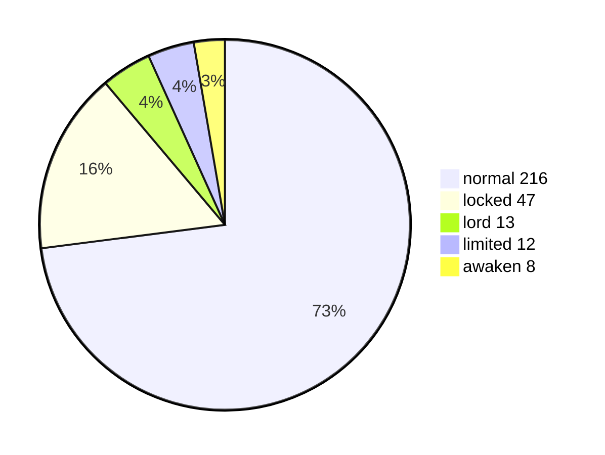

# V3 引擎重构：动手前先看清 20 批技能、机制与丢失设定 {#v3-collection}

V3 不是重写 v2，而是把 v2 已验证的「机制词表 + 契约门禁」从**事后清单**升级为**引擎骨架的类型系统**：技能从「各自写 handler」改为「声明式 SkillDef + 分面」。

- engines.txt 的「事件驱动 + 结算栈」方向对，但缺 9 大块；v2 已补出，却分散在 30 多个 hook 点，这是病灶。
- 296 个技能里，转换技与「回合内主动 + 回合外响应」应拆成多个技能面（face），其余用声明式订阅解决。
- 机制词表 49 条、手牌武器「武器 = 特殊技能注入」是继承基线，不是重造对象。
- PPO 蓝图（自对弈 + 隐状态 + 信念状态）是 Suphx / Pluribus / DouZero 验证过的正路，是目标不是子问题实验；V3 只交「RL-ready 接口 + 观测编码」。

@answer scope="三国杀 V3 引擎重构预研 · 2026-11-12 立案"
@meta locale=zh-CN

## 设想架构缺了什么？engines.txt 对比 v2 {#gap}

| 维度 | engines.txt 骨架 | v2 现状 | V3 要求 |
| --- | --- | --- | --- |
| 牌区归属 | 只有 `hand: Vec<CardId>` | 9 类区 + 守恒门禁 {good:已补} | 内核类型层 `Zone` 枚举 |
| 交互层 | 无（handler 只返回效果） | `Pending` + 出口类型级强制 {good:已补} | 内核 |
| 卡牌属性 | 4 个 `CardKind` | `CardDef` 字段化 {good:已补} | 生成物 `cards_generated` |
| 目标列表 | `targets: Vec` 无成员引用 | `target_chosen` 事件 + 列表 {good:已补} | 内核 |
| 伤害区分 | 单一 `Damage` 事件 | 伤害 / 失体力 / 减上限三出口 {good:已补} | 内核 |
| 询问完整性 | 无 | `must_ask` + 门禁 {good:已补} | 宪法 I1 |
| 帧数据归属 | 无 | 写发起帧 {good:已补} | 宪法硬约束 B |
| 窗口 / 主体 | 无 | `Window` + `subject` | 内核 |
| 播报队列 | `narration_queue` {good:有} | 文案由状态机生成 | V3 保留 |
| AI / 视图投影 | 无 | `view.rs` + `ai.rs` {good:已补} | 纯投影层 |

@facts id=engine-numbers
| 对比对象 | 规模 |
| v2 注册技能 | 296 个 |
| v2 技能层源码 | 约 3.4 万行（20 个批次文件） |
| 机制词表 | 49 条 |
| 真机缺陷类别 | 7 类（ADR-0042） |
| 牌表 | 160 张 |

## V3 引擎长什么样 {#layers}

@architecture id=v3-layers title="V3 分层：规格先行、内核零技能名、技能纯声明"
| specs | 语义宪法 + 契约 + 机制词表 | security |
| kernel | 规则内核：9 区 / 事件 / 交互 / 结算 / 伤害 / 牌 | backend |
| registry | 机制注册表（49 条 → enum + 覆盖校验） | database |
| skills | 声明式 SkillDef：分面 + 订阅 + 授予技 + 装备技 | backend |
| view | 纯投影：公共 / 个人 / 特殊区 | frontend |
| ai | 观测流 + 决策点 + 掩码 + 奖励接口 | backend |
| web | Web 端复用（targetPicker / 三分区 / 浮层） | frontend |
| specs > kernel | 门禁约束 | dashed |
| kernel > registry | 机制即数据 |
| registry > skills | 技能只读注册表 |
| kernel > skills | 内核不认技能名 |
| skills > view | 视图派生，不写第二份清单 |
| view > web | 视图契约 80 字段 |
| skills > ai | 合法集 → 掩码 |
| ai > kernel | 只提交动作，引擎重校验 | emphasis |

## 296 个技能怎么分类 {#skill-taxonomy}

| 机制难表达的形状 | 数量 | 代表 | V3 对策 |
| --- | --- | --- | --- |
| 转换技（阴阳） | 4 | 拒战 / 审时 / 成略 / 贞良 | 拆成多个 face，各自声明窗口 |
| 多触发技能 | 25 | 审时(3) / 激昂(3) / 雷击(3) | `subscriptions[]` 声明式订阅 |
| 主动 + 触发并存 | 17 | 极奢 / 挑衅 / 缔盟 / 父魂 | 按「是否共享意图」有条件拆 face |
| 多阶段窗口 | 60+ | 极奢 / 明任 / 箜声 / 良姻 | 窗口参数化 + 有序 steps |
| 授予技 | 约 10 | 伪帝 / 化身 / 绝响 / 怀柔 / 清侧 / 排异 | 一等公民进注册表 |
| 主公技他人侧 | 13 | 激将 / 护驾 / 颂威 / 兴衰 / 立军 | `LordSide` 枚举 + TABLE + 覆盖校验 |

@callout id=face-rule level=note title="拆 face 清单（O1=B 已裁定）"
拆 6：贞良/拒战/审时/成略（转换技）+ 父魂/酒诗。不拆 11：镇骨/活墨/匡弼/极奢/放权/长标/挑衅/缔盟/明策/渐营/燕语。单列 2：激将（主公技 relay）、陷嗣（他人侧）。边界 = 两面是否共享同一资源与意图。

## 继承什么、补什么 {#inherit}

@facts id=inherit-numbers
| 类别 | 内容 |
| 继承（不重写） | 机制词表 49 条、775 条裁定锚点、160 张牌生成物、视图契约 80 字段 |
| 补齐（v2 缺失） | 武器特效抽象（武器 = 特殊技能注入）、授予技一等公民、大厅 / 身份 / 中断 / 武将包 / 特殊区 |
| 武器特效 | 11 种武器 + 4 种防具，全部走 equip-skill 注入，内核零改动 |

| 丢失设定（v2 初期缺、后期才补） | 补回切片 | V3 要求 |
| --- | --- | --- |
| 大厅 / 选将 | S1 | 开发前纳入状态机 |
| 身份局完整（忠 / 内 / 配比 / 奖惩） | S1 | 开发前纳入 rules |
| 机器人座位 / 中断 / 武将包 | S1 | 开发前纳入 |
| 武器特效 9 种 | S2 | 开发前登记（equip-skill） |
| 谮毁「代用 / 额外目标」时序 | S2 | 内核「结算前钩子」先行 |
| 回合外主动技轮询 | S2 | 驱动器轮询纳入 |
| 特殊区 / 视图 46 字段 | S3 / S4 | 视图契约先行 |

@callout id=card-fix level=warning title="三张牌修正 + 藤甲二维伤害（已对齐）"
白银狮子：伤害恒 1 + 离开装备区（弃置/移动）回 1 体力。藤甲：火 +1；普通杀无效（含转化普杀）；南蛮/万箭无效；雷正常；其他伤害/流失有效。方天画戟：额外至多 2 目标（合计 1–3）。藤甲判定 = `damage_kind`（fire/thunder/normal）× `source_kind`（slash/nanman/wanjian/duel/skill/hp_loss）两维。

@callout id=grant-fix level=warning title="授予技缺口（已补权威描述）"
11 个授予技：8 已实现（攻心/荐言/急袭/思蜀/和弦/柔弦/烈弦/激弦）+ 3 未实现（怀柔/清侧/排异，只有文本无效果）。他人侧可发动（非主公技）= 2（陷嗣移逆出杀、蛊惑质疑）。V3 需统一「他人侧/授予」机制覆盖全部。

## AI：PPO 是目标，V3 只交接口 {#ai-fit}

PPO 蓝图（自对弈 + 隐状态 + 信念状态）是 Suphx / Pluribus / DouZero 验证过的正路，是最终目标。V3 的 AI 交付物是「RL-ready 接口 + 观测编码」，不是 PPO 实现。

| 上一版的担忧 | 蓝图给出的解法 | 结论 |
| --- | --- | --- |
| 部分可观测（他人手牌身份隐藏） | RNN / GRU / Transformer 隐状态 + 对手建模 + 信念状态 | 有解 |
| 对手非平稳 | Self-Play 策略池 + Elo 采样 + 熵正则 | 有解 |
| 合法集动态 | `legal_actions` = 物理规则掩码（引擎已天然实现） | 免费 |
| 多目标 | 奖励按身份不同，每座位终局 +1 / 0 | 简化 |
| 局时长 / 稀疏奖励 | GAE λ≈0.95 + 只给终局奖励 | 有解 |
| 多人 5–8 | 自对弈控制全部座位 | 有解 |

@steps id=ai-path
| interface | 先锁三接口 | V3 产出观测 / 掩码 / 奖励 schema，Gym 风格、SB3 无关 | v3-layers | ai |
| distill | BC 蒸馏预热 | 用现有启发式 AI 蒸馏成初始策略，省 sample | v3-layers | ai |
| ppo | 自对弈 PPO | SB3 起步，必要时迁 RLlib；目标就是它 | v3-layers | ai |

@callout id=ai-gap level=warning title="四个 V3 就要埋桩的真问题"
观测张量序列化（160 牌变长 + padding + 可见性掩码）是硬骨头；内奸奖励不平衡需单独归一化；局内确定性规则奖励（杀反摸 3 / 主杀忠弃牌）要进但分层；计算预算需 BC warm start，别从零 self-play。

## 已裁定（2026-11-13） {#open}

- [x] O1 拆 face：**B 有条件拆** —— 拆 6（贞良/拒战/审时/成略 + 父魂/酒诗）、不拆 11、单列 2（激将 relay / 陷嗣 他人侧）
- [x] O2 授予技一等公民：**A** —— 怀柔/清侧/排异已补权威描述
- [x] O3 武器 = equip-skill 注入：**A**（沿用 v1 口径）
- [x] O4 声明式 SkillDef 取代 handler：**A**
- [x] O5 AI：**C + SB3/PettingZoo 参数共享**（不上 RLlib）
- [x] O6 复活 v1 做 oracle：**A**（M0 就做）
- [x] O7 机制 49 条全进内核：**A**（落地分批，防漂移靠 CI 差分对拍）

@source v2-registry title="v2 技能注册表快照" path=crates/engines/sanguosha2/examples/sgs2-registry.rs lines=1:60
@source mechanics title="共享机制词表 49 条" path=docs/games/sanguosha/align/mechanics.json
@source adr0042 title="ADR-0042 废弃 v2 启动 V3" path=memory_palace/decisions/ADR-0042-v3-rebuild.md
@source collection title="V3 预研稿全文" path=memory_palace/plan/next-v3-collection.md
